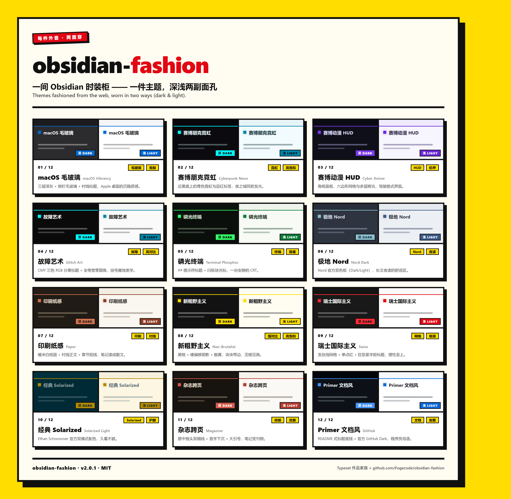

# obsidian-fashion · 项目自述

> **Themes *fashioned* from the web, *worn* in two ways (dark & light).**
> 从万千网页 UI 风格中裁制而成的 Obsidian 主题——每件外套，两面穿。

## 这是什么

**obsidian-fashion** 是一间持续上新的 Obsidian 时装柜：macOS 的毛玻璃克制、
赛博朋克的霓虹发光、机甲 HUD 的角框与六边形网格、故障艺术的 RGB 分离，
也有 Paper 印刷、Swiss 国际主义、Magazine 杂志跨页、Terminal 磷光终端这些
经典剪裁；Nord、Solarized、GitHub 的配色直接采用官方色板。

这里的每件主题都内置**深、浅两副面孔**——切一下 Obsidian 基础模式，或开启
「自动跟随系统」，日落换深色、日出换浅色，无缝完成。一个主题，两副面孔。

同款主题也穿在 [Typeset](https://github.com/Fogecode/Typeset) 导出的网页上：
笔记穿什么，导出就穿什么。

## 三件值得说的事

1. **两面穿是标配，不是选项。** 每件主题的两套配色都完整覆盖正文、标题、
   表格、标签、代码、悬停整套界面域——不是"深色随便反转一下"的凑数浅色。
2. **血统讲得清。** 四套译自知名网页 UI 风格库的设计语言，八套承袭自家
   导出器 Typeset 的经典主题，官方配色系（Nord / Solarized / GitHub Dark /
   macOS）直接采用源头色板——README 附完整致谢。
3. **好看，也经得起用。** 全部纯 CSS、零 JS、零联网；每套配色都通过
   WCAG 对比度审计，变量名对照官方 app.css 逐个核验；特效三档可调
   （静态 / 轻特效 / 全特效），不爱动的可以一键归零。

## 上架名录

| # | 主题 | 两面穿 | 标签 |
| --- | --- | --- | --- |
| 01 | macOS 毛玻璃 / macOS Vibrancy | 深三层灰 ↔ 浅 macOS 灰 | 毛玻璃 · 克制 |
| 02 | 赛博朋克霓虹 / Cyberpunk Neon | 深霓虹 ↔ 冰蓝日霓虹 | 霓虹 · 高饱和 |
| 03 | 赛博动漫 / Cyber Anime | 深紫 HUD ↔ 淡紫日间 | HUD · 机甲 |
| 04 | 故障艺术 / Glitch Art | 纯黑 CMY ↔ 复印纸 | 故障 · 高对比 |
| 05 | 磷光终端 / Terminal Phosphor | 磷光绿 ↔ 纸带绿 | 终端 · 极客 |
| 06 | 极地 Nord / Nord Dark | Nord Dark ↔ Nord Light（官方） | Nord · 夜读 |
| 07 | 印刷纸感 / Paper | 暖米白 ↔ 夜航书 | 印刷 · 衬线 |
| 08 | 新粗野主义 / Neo-Brutalist | 黑框酸黄 ↔ 黑底黄影 | 强对比 · 高饱和 |
| 09 | 瑞士国际主义 / Swiss | 白底红点 ↔ 深灰亮红 | 网格 · 极简 |
| 10 | 经典 Solarized / Solarized Light | Light ↔ Dark（官方） | Solarized · 护眼 |
| 11 | 杂志跨页 / Magazine | 米白刊物 ↔ 午夜刊 | 排版 · 优雅 |
| 12 | Primer 文档风 / GitHub | GitHub Light ↔ Dark（官方） | 文档 · 耐看 |

每件的深浅双模式实拍见 [screenshots/](../screenshots/)（`<主题>-dark.png` /
`<主题>-light.png` 成对存放）。

## 怎么穿（三步）

1. 把 `themes/` 下喜欢的**整个主题文件夹**复制到 `<vault>/.obsidian/themes/`
2. Obsidian 里 `Ctrl+P` → `Reload app without saving`
3. `设置 → 外观 → 主题` 选择；切深浅就切「基础模式」（或开自动跟随系统）

不喜欢就换回默认，想删就删文件夹——主题是纯装饰层，笔记与配置零风险。

## 家族与许可

作者作品家族：[Typeset](https://github.com/Fogecode/Typeset)（排版导出）×
obsidian-fashion（穿衣打扮）。MIT 开源，素材来源与致谢见
[README](../README.md#致谢与素材来源attribution)。
